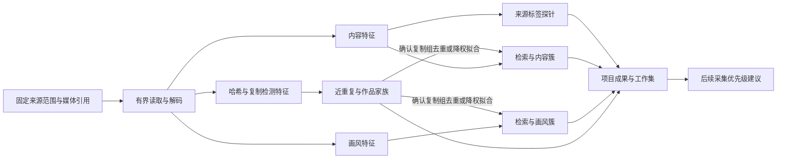

# 数据湖聚类与检索规划

创建及更新日期：2026-10-11。

状态：讨论规划与研究基线。当前完成的是项目只读检查、公开资料核对和方案整理；尚未运行本地视觉模型、形成聚类结果或验证全湖处理吞吐。本文不代表相关能力已经接入 Studio，也不冻结数据库、API 或模型选型。

## 文档入口

- [模型候选与取舍](model-selection.md)：SigLIP 2 两个版本、EmbeddingGemma 2、Kaloscope 2.0/3.0、近重复检测模型，以及候选优先级的调整理由。
- [评估与分阶段推进](evaluation-plan.md)：样本、困难图片对、画风评估、吞吐测量、阶段产物和进入下一阶段的依据。
- [多来源采集规划](../Dataset%20Scraping/README.md)：采集器、统一调度和数据保留的既有边界。

## 背景与目标

Dataset Studio 已接入 Danbooru、Yandere、Gelbooru 三个 Booru 湖，以及 Pixiv、Pinterest 两种独立来源的数据湖。来源增多后，同一作品的跨站转载、不同编码、裁切、差分版本，以及题材和质量分布的差异，会提高人工浏览与筛选成本。

当前目标是在进一步扩大 Pixiv、Pinterest 采集前，建立便宜、可复用的本地视觉处理能力，首先理解已有数据的分布，再用分析结果改进工作集筛选和后续采集投入。

Pinterest 的来源规模、发现入口和元数据条件决定了本地不宜以完整归档源站为目标。需要逐渐回答：本地已经覆盖哪些内容、哪些作品重复较多、哪些内容稀缺，以及哪个采集入口能补充有效内容。

预期首期产品成果是：跨湖相似检索、近重复关系浏览、内容与画风聚类浏览，以及由分析结果派生工作集。质量评分、领域微调和自动调整采集预算按证据逐步引入。

## 已明确的需求与当前规划取向

下表区分用户明确的要求与当前建议。后续实验可以修订候选安排，不应把研究建议当成已经验收的生产结论。

| 性质     | 内容                                                     | 对后续工作的约束                                         |
| -------- | -------------------------------------------------------- | -------------------------------------------------------- |
| 明确需求 | 以现有五类数据湖的本地低成本预处理和聚类为起点           | 先分析已有数据，再研究采集反馈                           |
| 明确需求 | 画风聚类是重点研究方向                                   | 需要独立的画风样本与验收，不能只用题材或画师识别成绩替代 |
| 明确偏好 | 优先保留原图长宽比与整图几何关系                         | 通用视觉候选优先 NaFlex；裁剪型领域模型单独评价输入损失  |
| 明确取舍 | 不安排完整维度与压缩维度的对比实验；FP32 存储也可接受    | 保留模型原生完整输出，不把 MRL、PCA 或量化作为当前主线   |
| 当前建议 | 内容、画风和复制图检测分别建模                           | 分开保存特征、关系和评估结果，不预设单一向量包办所有任务 |
| 当前建议 | NaFlex 与 EmbeddingGemma 2 比较通用内容能力              | 尚未选定通用生产模型                                     |
| 当前建议 | Kaloscope 3.0 为画风重点候选，原版 DINOv3 尽早参与对照   | 2.0 保留领域对照，CSD 后续补充；画风效果尚待实测         |
| 当前建议 | 感知哈希与 SSCD 互补检测近重复                           | 不预先固定相似阈值或自动删除规则                         |
| 当前建议 | 拟合前按高置信度复制组去重或降权，成员可按自身特征归簇   | 作品家族关系不强制决定内容簇或画风簇归属                 |
| 当前建议 | 保留整图参照，画风另评多个尺度的局部区域与组合表示       | 原生像素不等于一致的观察尺度；发布配方保留为基线         |
| 当前建议 | NaFlex 作纯视觉内容空间，EmbeddingGemma 2 作图文语义空间 | 两者职责可并存，不预设只保留一个通用模型                 |
| 当前建议 | 以来源标签在特征上训练轻量探针，迁移到弱元数据来源       | 探针输出是带置信度的建议，不等同人工确认或来源事实       |
| 当前建议 | 先做小样本可视检索切片，再展开正式评估                   | 早期以人工观察邻居暴露失效模式，正式指标随后校准         |

## 分别表达的关系

CLIP、SigLIP 等编码器产生特征，检索与聚类算法消费特征。选择特征时先明确希望保留哪种相似关系。

| 关系或属性     | 需要回答的问题                                 | 建议结果                         |
| -------------- | ---------------------------------------------- | -------------------------------- |
| 字节相同       | 是否为完全相同的保存文件？                     | 校验后的内容身份与计算复用       |
| 复制与版本关系 | 是否为同一作品的转载、重编码、裁切或加字版本？ | 带依据的近重复候选和作品家族     |
| 有意义的差分   | 表情、服饰、构图、文字等差异是否值得保留？     | 独立成员及版本关系               |
| 内容语义       | 题材、主体、场景、动作与构图是否相近？         | 内容检索索引与多粒度内容簇       |
| 画风           | 线条、上色、材质、笔触和完成方式是否相近？     | 独立画风索引与画风簇             |
| 角色           | 是否描绘同一角色或相近角色属性？               | 标签或专项角色关系；保留不确定性 |
| 质量与适用性   | 是否适合某个工作集、训练或采集目标？           | 独立分数、人工判断与筛选规则     |

一张图片可以同时属于内容簇、画风簇、角色组和作品家族。稀有图片不自动视为噪声，小簇也不自动视为有价值；需要检查其成员是否视觉一致、是否只是水印、边框或采集伪影相似。

代表图的选择是工作集或导出策略。可综合原始出处、画面完整度、实际细节、分辨率与编码质量判断，不只按像素尺寸选最大文件。分析关系本身不触发原湖文件删除或来源记录合并。

## 项目接入方向

### 现有基础与缺口

本轮源码检查确认：项目已分离图片身份、来源记录和历史观察；统一来源入口支持受预算约束的读取，项目已有固定输入、成果与工作集机制。尚未发现已实现的本地视觉嵌入、感知哈希、SSCD 和跨湖聚类链路。

- [ADR 0035](../../decisions/0035-source-registry-and-dispatch.md)：项目成员保持 `source_id + asset_id`，跨湖同 SHA 不直接合并身份。
- [ADR 0004](../../decisions/0004-tools-artifacts-session.md)：固定输入、版本化成果、引用与缺失状态；原有单标量实现不能直接当作大型向量存储方案。
- [ADR 0052](../../decisions/0052-pixiv-collections-and-canonical-media.md)：Pixiv 作品、媒体清单、来源资产、物理对象及派生图片的区别。
- [ADR 0074](../../decisions/0074-pinterest-archive-containers.md)：Pinterest 逻辑路径与实际容器读取的关系。
- [当前媒体批读实现](../../../crates/studio-sources/src/backends/canonical/catalog.rs)：批内按实际包与偏移排序，目前限制为最多 16 个对象、总计 64 MiB。它提供复用基础，尚不构成全湖 GPU 特征流水线。

### 特征、索引与项目成果

拟采用以下逻辑分工，具体格式、服务位置和接口仍待实施设计：

1. **共享视觉特征材料。** 按已校验内容哈希、权重版本、特征提取位置、预处理和数值配方标识计算结果。相同字节可以跨来源、跨项目复用计算，但不改变原有来源身份。原图与转码图分别保留身份，近似关系由分析层建立。
2. **可重建检索索引。** 从固定版本的特征材料构建，记录覆盖、参数及构建版本。内容、画风、复制检测模型的坐标空间独立，不把来自不同模型的向量直接混用。索引实现和参数暂不锁定。
3. **项目内分析成果。** 保存输入范围、特征版本、聚类版本、成员引用、代表图、关系证据与人工修正。簇编号只在对应成果版本中有意义，不作为永久的作品或风格身份。

数据湖继续保存原始事实，分析结果作为派生材料。相同图片的元数据刷新通常不需要重算纯视觉特征；输入成员、元数据条件或聚类参数变化仍需形成对应的新分析版本。

新图片可以先计算特征、检索邻居并尝试归入既有簇；离群和新内容保留为待分析成员。何时重聚类、如何表达簇拆分合并与历史结果之间的联系，尚未确定。重新计算不能静默改写已有工作集或已消费的成果。

### 处理与恢复

优先围绕物理包和偏移组织连续读取，在读取、解码、GPU 推理和持久写入之间设置有界队列与背压。前端使用范围引用和分页，不搬运全湖 ID 或向量。

特征提取应能够分片提交、取消、恢复及增量补算。每项保留成功、未计算、失败、缺失和不支持等状态；资源等待不能当作图片质量失败。覆盖统计与任务进度应能说明哪些图片实际产生了有效特征。

冻结输入时保留来源版本与对应引用。预处理记录方向校正、颜色与透明背景处理、缩放或裁剪、动画或多页媒体的取样规则。首轮以静态图片对象为主要研究范围，派生帧与原始动画不得混为同一种证据。

模型权重、真实特征、索引、图片样本和逐项日志存放在受管的本地数据目录，不提交 Git。新增永久格式、兼容性和模块职责在实施前形成对应架构决策。

## 聚类、质量与采集的关系

### 聚类与筛选

聚类拟合前先降低转载副本的重复权重：SHA-256 复用字节相同的计算，感知哈希与 SSCD 产生复制与作品家族候选。经过校准的高置信度复制组可选代表参与拟合，或按组降权；不直接把所有近重复候选合并。跨湖转载若各自以完整权重参与拟合，可能形成密集伪簇并拉偏簇中心，实际影响通过对照拟合评价。

作品家族与复制组分别表达。同一作品的完整图、局部裁切、线稿版、上色版和有效差分可以保持家族关系，同时按各成员自身的内容、画风特征独立归簇。只有在相应任务下高置信度、视觉等价的转载副本才适合继承代表的归属。拟合时的代表或权重不改变来源身份，也不替代工作集或导出时的代表图选择。

首先使用可解释的多粒度分组和相似检索帮助浏览。球面或分层 K-means 可作为研究起点；簇数、层级深度、离群处理和检索后端由实验确定，不照搬外部报告参数。避免全体图片两两比较；大规模邻居检索需要独立检查近似索引的召回。

质量分数与簇成员分开。阈值随具体任务确定，允许人工标注“保留、排除、待复核”并保留依据。现有美学排序可作为后续消费分析结果的模块，不能把视觉聚类解释为已经完成美学判断。

### 来源标签探针

Booru 与 Pixiv 带有可作弱标签的元数据，例如 AI 生成标记、漫画、线稿、截图、照片和低质量相关标签；Pinterest 的结构化分类较少。可在已计算的视觉特征上训练线性或浅层探针，以有标签来源拟合，再对弱元数据来源给出带置信度的属性建议。先验证漫画、线稿、照片等属性；AI 生成识别另设评估，检查不同生成模型、画风与后处理条件下的迁移，不能由其他属性成绩代替。AI 生成、质量与任务适用性分别表达，筛选规则由工作集用途决定。

Pinterest 也有可利用的来源信号：现有[元数据适配器](../../../crates/studio-sources/src/pinterest_metadata.rs)已支持读取 `is_ai_generated` 与 `gen_ai_topics`，并区分缺失、显式 null 与明确值。它们可与 Pixiv AI 标记、Booru 的 `ai_generated` 类标签一起作为辅助弱标签，但字段覆盖率、来源间语义和可靠性仍待采样核实；读取支持不等于完整或准确的标注。

探针输出单独保存为派生预测，与来源标签、人工确认分开；来源标签存在缺标和误标，迁移到 Pinterest 的效果须在 Pinterest 人工样本上另行评价，不能用 Booru 内部成绩代替。

### Pinterest

从已有 Pin、图版、搜索与推荐候选出发，评价新增独立内容、目标内容覆盖、近重复率、取得成本和更好版本的收益。分析结果先用于优先级建议，并保留探索预算，避免只沿已有密集内容扩展。

Pinterest 的标题、说明和图版名称缺少统一结构，可用于研究 EmbeddingGemma 2 一类图文联合表示；图版或作品集合也可研究以多图联合输入形成集合级表示，用于比较候选图版与本地已有内容的距离。这是应用安排，不预设它与 NaFlex 的纯视觉效果优劣。来源标签探针可在目标来源验证后，为候选图版的抽样图片提供 AI 生成、截图、照片等属性估计，作为优先级建议的一部分。

本地图像特征本身不是 Pinterest 的站内种子身份。需要通过已知 Pin、图版、来源链接或检索词把本地需求映射到现有采集入口。图版样本的评价与整版质量分开记录。

### Pixiv

沿用作者为核心的来源采集语义。已有 Booru/Pixiv ID、来源链接和作者关系可形成候选，再结合本地作品覆盖、重复情况和内容缺口安排优先级。模型相似度只提供关联线索，不替代来源身份核对。

### 下载前预筛的边界

当前研究优先处理本地已取得媒体。后续若引入远端缩略图预筛，需要独立评价缩略图与原图差异、阈值、误排除及成本收益，不能把当前本地图像评估结论直接迁移过去。

暂缓候选应保留元数据、发现上下文和原因，不能记为已完成取得；保留元数据也不保证未来仍能下载文件。相关既有约定见 [Pinterest 发现策略](../Dataset%20Scraping/pinterest-discovery-strategy.md)。

来源采集器继续管理发现、分页、身份、可见性和覆盖；共享分析产出可消费的建议，统一调度管理资源和运行优先级。

## 尚未决定的事项

- 通用内容与画风空间各自的最终模型，以及是否需要领域微调。
- Kaloscope 画师监督对跨画师画风关系的偏置，以及整图输入的适配方式。
- 感知哈希、SSCD 的组合、阈值、差分保留规则和候选召回目标。
- 特征分片格式、索引后端、CPU/GPU 执行器以及模型生命周期管理。
- 聚类粒度、增量分配、新簇发现和历史簇版本的对应方式。
- 质量分类头与人工判断怎样参与工作集规则。
- 画风输入采用发布配方中心裁剪、整图保比例还是整图与多尺度局部组合，以及区域尺度、选取与聚合方式。
- 高置信度复制组的代表或降权规则、归属继承条件，以及复制组和作品家族变化后既有成果如何对应。
- 来源标签探针覆盖哪些属性、置信度如何呈现、来源字段的覆盖与可靠性，以及 AI 生成识别和 Pinterest 迁移的人工校验规模。
- 何时把采集建议升级为自动预算调整，是否开展下载前预筛。

## 推进顺序

先用约 2 万张分层样本建立候选图库，以感知哈希、NaFlex、Kaloscope 3.0 生成首批邻居，在临时浏览页中抽查分层查询的前若干邻居。首轮画风比较尽早加入原版 DINOv3，在相同候选范围内对照；CSD 作为后续补充。该切片用于发现水印、签名、边框或内容因素主导相似度等失效方式，不要求人工穷举全部图片，不作为模型选型结论，也不进入 Studio 正式格式。根据观察到的问题再展开多尺度区域和属性探针实验。

随后建立有固定样本与人工依据的研究面板，完成内容、画风和近重复的分项比较；再扩大到建议的 5～10 万张分层样本，测量完整处理链路；之后接入持久特征、检索、浏览和工作集派生，最后评价采集反馈。

各阶段的建议产物和通过依据见[评估与分阶段推进](evaluation-plan.md)。样本规模、硬件参数和阶段顺序是当前研究安排，不构成全湖吞吐、质量或完工时间承诺。
