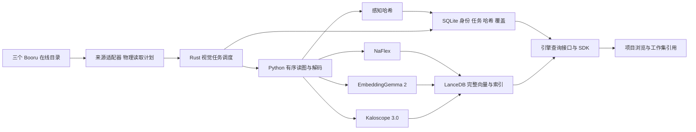

# 三个 Booru 数据湖的视觉特征后端设计

日期：2026-10-11。状态：拟实施的架构与接入方案。

当前工程直接面向 Danbooru、Yandere、Gelbooru 三个真实数据湖，提供 SHA 复用、感知哈希、向量提取和相似检索。首批接入 SigLIP 2 NaFlex、EmbeddingGemma 2、Kaloscope 3.0-preview，三个向量空间并存，便于在同一批真实图片上比较效果。批次大小、输入配方和检索参数随实际运行调整。

采用 Rust 引擎调度、独立 Python 视觉服务、SQLite 管理身份与任务、LanceDB 保存完整向量并建立本地磁盘索引。共享材料放在 SSD，项目通过引用使用。首批工作集中于这条处理链，不以前置完成后续聚类、标注工作台或采集反馈为条件。

## 当前规模和存储选择

2026-10-11 从三个湖的 `ONLINE.json` 与在线库 `publications` 读取的规模如下。统计使用已发布图片对象数，尚未扣除跨湖同 SHA 的重复；没有读取图片包或执行全湖图片扫描。

| 湖       | 发布序号         | 图片对象记录 |
| -------- | ---------------- | ------------ |
| Danbooru | 19095            | 11,657,522   |
| Yandere  | 1540             | 1,157,019    |
| Gelbooru | 53270            | 4,134,978    |
| 合计     | 各湖分别固定版本 | 16,949,519   |

本机约有 93.6 GiB 系统内存、32 GiB 显存。图片归档位于 E 盘的 USB 连接设备；在线目录位于 F 盘的 8 TB NVMe SSD，检查时空余约 7.16 TiB。建议共享视觉材料根目录使用 `F:\Dataset\Visual Features`，由设置保存路径，与项目目录及程序源码分开；实现时再创建。

以每条对象记录均产生一份向量计算，原生完整维度的 FP32 体积如下，使用十进制 GB。跨湖 SHA 复用会减少实际数量；表内不含索引、元数据、旧版本和构建临时空间。

| 模型                         | 输出维度     | 原始向量估算 |
| ---------------------------- | ------------ | ------------ |
| SigLIP 2 SO400M/16-NaFlex    | 1152         | 78.10 GB     |
| EmbeddingGemma 2             | 768          | 52.07 GB     |
| Kaloscope 3.0-preview 检索头 | 256          | 17.36 GB     |
| 合计                         | 三个独立空间 | 147.53 GB    |

SSD 足以保存这些材料，但三套向量不适合同时装入内存。向量使用列式分片存储，批量计算按块扫描，交互检索通过磁盘索引选取候选。IVF_FLAT 索引会另外保存未量化的向量数据，容量规划先按原始向量约两倍考虑，再给版本保留、重建和临时文件留空间；不能把 147.53 GB 当作全部占用上限。

## 模块分工

Rust 引擎拥有任务入口和业务状态，复用现有来源注册、版本保留、资源优先级及项目身份。Python 服务使用单独环境，接收已解析的读取范围，完成解码、模型推理、批量写入和检索。计算代码与命令行入口共享同一套实现。

视觉服务沿用 [lake-worker 的分发与托管方式](../../decisions/0040-owned-lake-worker-and-image-recipes.md)，使用独立解释器配置。服务常驻，权重按需要加载并复用；任务提交迅速返回，进度和取消由独立控制消息处理。向量不经 HTTP 或 JSON 按百万条传输，模型下载也不放在请求处理路径内。

GPU 推理与 CPU 检索使用独立执行队列。交互查询可以在后台提取期间运行，模型加载与 GPU 前向由同一个调度入口串行协调。首版不承诺多个模型同时前向，也不依赖所有模型始终驻留。

## 读取与 I/O

### 从目录生成物理读取计划

当前 [Catalog](../../../crates/studio-sources/src/backends/canonical/catalog.rs) 的普通分页按 SHA 排序，`read_many` 只在最多 16 张、64 MiB 的批次内按物理位置排序。三湖在线库的 `objects` 有 SHA 唯一索引与 `first_seq` 索引，没有 `(pack_path, offset)` 索引。实际查询计划显示，直接按物理位置排序需要临时排序表。

因此增加面向批处理的媒体投影接口。引擎固定每个湖的发布版本，流式读取对象目录，在视觉材料根目录建立可恢复的读取清单，并一次性按物理包和偏移组织。后续分页读取这份清单；避免每取得下一批都对整个在线库重新排序，也不修改原湖的索引模式。

清单记录来源身份、库版本、内容 SHA、物理包、偏移、长度和格式。全湖目录按块消费，不在内存或前端积累千万个 ID。已完成的 SHA 与请求配方先在覆盖目录中排除，同 SHA 的来源记录共用一次计算；新增来源关联仍需保存。新批次可通过 `first_seq` 继续发现对象，来源代际变化则重新建立对应清单。

来源版本保留使用现有 `retain_version` 与 `release_version` 能力。清单中的物理路径是执行位置，内容 SHA 才是计算身份；湖重连、迁移或代际变化后由来源适配器重新解析，视觉任务不绕过原有来源生命周期管理。

### 让视觉进程直接读取已声明的范围

Python 不连接三湖在线库，只消费引擎批准的文件范围。按包打开文件并递增偏移读取，可以连续处理同包图片，省去图片字节在 Rust 与 Python 之间的再次复制，也不为全湖任务先复制一份原图到 SSD。

引擎在派发范围前取得读取额度，范围包含取消标识、长度上限和受管根目录。Python 只能只读打开这些范围，核对实际长度与 SHA，完成后关闭或交还对应文件句柄并确认；进程退出时引擎收回执行额度。界面读取保留更高优先级，同一归档设备上的后台读取默认串行调度。

压缩字节、解码图片和待写向量分别设置缓冲预算。CPU 解码可以有限并行，GPU 从准备好的批次取数据；队列满时暂停上游读盘。预算按字节、像素和模型实际输入量计算，不能只限制图片张数。

多模型任务尽量共享一次读取与解码，各适配器分别缩放、裁剪和归一化。保留解码图到已选模型消费完成；显存不足时分组运行这些模型，而不重新读取原图。单个模型失败只留下该配方的待补算项，其他成功结果可以正常提交。

## 模型接入

| 适配器                | 首版输入与输出                              | 接入注意点                                                                           |
| --------------------- | ------------------------------------------- | ------------------------------------------------------------------------------------ |
| NaFlex                | 保比例，784 patch 起步；1152 维归一化向量   | 提取图像表示，保持模型自身处理器的尺寸和 mask 逻辑                                   |
| EmbeddingGemma 2      | 纯图片，默认 280 soft token；完整 768 维    | 加载图文所需模块，前向使用 BF16 或 FP32，不使用 FP16；图文联合输入后续作为独立配方   |
| Kaloscope 3.0-preview | 发布配方，短边 512 后中心裁剪；256 维检索头 | 原始 Encoder 输出是 1536＋256 的拼接，需要取正确的投影部分；不把画师分类输出当作向量 |

三个适配器统一提供描述、加载、输入准备和批量提取接口，输出有限值的 FP32 归一化向量及逐项错误。前向精度与保存精度分别配置。Kaloscope 的整图、多尺度输入可以随后增加配方，现阶段先把发布路径接对。

首版模型处理静态图片。方向校正、颜色和透明背景处理纳入配方；动画、视频或解码器尚不支持的对象保留明确状态，不静默取首帧充当整个原件的特征。它们仍可参与已有 SHA 的来源关联，模型覆盖另行统计。

配方保存模型修订与权重摘要、预处理版本、输出位置、输入预算和前向精度。同一份已校验图像字节加同一配方对应可复用的结果。改变模型或预处理时创建新配方，旧结果继续可读。

环境安装脚本独立于采集服务，依赖包括 PyTorch、支持当前模型的 Transformers、Kaloscope 所需主干实现、Pillow、ImageHash、NumPy、PyArrow 和 LanceDB。版本在实际安装并跑通三款模型后锁定；下面的存储验证版本不代表整个模型环境已经完成兼容性验证。

模型依据：[NaFlex 配置](https://huggingface.co/google/siglip2-so400m-patch16-naflex/blob/main/config.json)、[EmbeddingGemma 2 使用要求](https://huggingface.co/google/embeddinggemma-2#best-practices)、[Kaloscope 3.0 推理说明](https://huggingface.co/heathcliff01/Kaloscope3.0-preview)。

## 身份与哈希

共享目录给每个经过核对的 SHA 分配紧凑的 `object_id`。`source_id + asset_id` 通过来源关联映射到该对象，跨湖相同字节复用哈希与向量计算，来源身份保持独立。

SQLite 保存原始 SHA、来源关联、pHash、任务、批次和覆盖信息。pHash 作为独立配方保存算法及参数；首版可采用 64 位 pHash。查找近重复时使用按位分段的候选索引，再计算完整汉明距离，避免全湖两两比较。分段方式与枚举半径需要覆盖所选距离阈值；拥挤桶按块处理，不能静默截断候选后声称检索完整。

SHA 相同可以直接复用计算；pHash 相近先形成带距离的候选关系。候选展示和分组保留成员及关系依据，广义相似关系不会自动合并来源记录。相似向量与 pHash 可并排浏览，后续按实际误判决定是否补充其他复制检测模型。

## 向量存储与快速读取

### SQLite 保存控制信息

新增独立的 `visual.sqlite`，主要逻辑对象是 `objects`、`source_bindings`、`recipes`、`runs`、`batches`、`hash_values`、`feature_coverage`、`snapshots` 和 `failures`。表名可在实施时调整，职责保持清晰。

覆盖项按对象与配方记录成功批次，不预先为所有未计算组合铺满状态行；失败单独记录原因。写入按批提交，避免每张图一次事务。项目库保存视觉成果及查询结果引用，大向量和全湖计算状态位于共享材料目录。

### LanceDB 保存完整向量

首版使用本地嵌入式 LanceDB，每个配方独立一张表，向量类型为 `FixedSizeList<float32, D>`。每行至少包含 `object_id`、`batch_id`、`vector`，用对象 ID 标量索引支持点查，用流式 Arrow 批次支持顺序写入和后续批量计算。

检索投影另带紧凑的 `source_ids` 列及标签列表索引，支持在向量检索之前按来源过滤。SQLite 的来源关联是权威数据；该列只是检索投影，随发布版本更新。新增跨湖关联只更新这层映射，不重新执行模型。

Python 中按批使用 `to_batches()`，从 Arrow 的连续数值缓冲准备 CPU 或 GPU 计算输入；禁止把全表 `to_arrow()` 或 Python 向量列表当作日常读取路径。批次目标以字节数控制，FP32 输出可以持续追加，物理分片整理单独安排。首版不额外保存一份全量 NPY 文件，按需要导出指定范围即可。

### IVF_FLAT 负责交互检索

使用保留原始浮点向量的 IVF_FLAT。它先把向量分到若干近邻分区，查询时选取部分分区，在这些分区内计算真实向量距离；因此能够减少读取量，但跨分区候选召回仍是近似的。索引参数记录在快照中，内容与画风空间分别索引，不混合分数。

查询接口区分精确扫描和近似检索。小范围与对照计算可分块精确扫描，全湖交互查询使用索引；需要更高召回时扩大分区搜索范围。返回候选数量、实际方法、覆盖版本和分数类型，距离不包装成质量或画风置信度。

新增向量可以先通过未建索引的尾部扫描参与查询，然后批量更新索引。该尾部过大时会拖慢检索，因此后台维护根据未索引行数和查询耗时触发，而不是每写一批都重建全库。索引维护限制并发，并预留构建临时空间。

选择依据是本机 Windows 支持、完整向量索引与流式读取。[LanceDB 的 IvfFlat](https://github.com/lancedb/lancedb/blob/main/python/python/lancedb/index.py) 明确保存原始向量；[FAISS 当前构建文件](https://github.com/facebookresearch/faiss/blob/main/faiss/CMakeLists.txt)则仅在非 Windows 构建中加入 `OnDiskInvertedLists`。因此首版采用 LanceDB，不把 Windows 上的 FAISS 磁盘映射作为必需能力。

## 提交与恢复

引擎先登记批次意图，视觉服务作为受管写入者追加该批向量，返回 Lance 表版本与行数；引擎再提交 SQLite 的覆盖记录和可见版本。检索只读取已发布版本。写入成功但进度确认丢失时，恢复根据稳定 `batch_id` 核对已有数据，完成确认，不再次追加整批。

每张配方表同一时刻只允许一个写入入口。恢复完未确认批次后再继续追加；必要时使用对象 ID 的插入去重，已有成功结果不被重试覆盖。暂停和取消在批次边界收敛，成功的模型结果与已经保存的哈希保留。

已被项目引用的 Lance 版本以 tag 保留，同时保存覆盖与来源投影版本；项目引用解除后才允许回收。不得直接使用会删除旧版本的默认清理操作。索引维护、表整理和项目删除都通过引擎的共享材料引用管理，避免关闭一个项目就删除其他项目正在使用的特征。

## 后端接入位置

| 位置                                          | 首批职责                                         |
| --------------------------------------------- | ------------------------------------------------ |
| `crates/studio-domain/src/visual.rs`          | 模型、配方、任务、覆盖和查询结果的业务类型       |
| `crates/studio-application/src/visual.rs`     | 视觉存储、执行器和检索端口                       |
| `crates/studio-application/src/sources.rs`    | 增加可流式消费的批处理媒体投影能力               |
| `crates/studio-sources`                       | 三湖的固定版本对象枚举与物理范围解析             |
| 新增 `crates/studio-visual-store`             | 共享 SQLite 目录、读取清单、批次确认与成果引用   |
| 新增 `services/visual-worker`                 | 三款模型、pHash、范围读取、Arrow 与 LanceDB 适配 |
| `crates/studio-engine/src/visual`             | 常驻服务托管、任务调度、额度、恢复和进度         |
| `crates/studio-resources`                     | 复用读取优先级，补充视觉执行与设备读取额度       |
| `crates/studio-protocol` 与 `packages/client` | 公开 DTO、路由及 SDK                             |
| `tooling`                                     | 独立环境安装、源码打包、按范围检查入口           |

domain/application 保持不依赖 Python 进程、SQLite、LanceDB 或 HTTP。视觉处理是应用级共享任务，不能直接套用当前项目工具的单行标量计算接口；创建任务时可记录发起项目，但项目关闭不自动销毁共享计算与材料。

初始 API 围绕以下操作提供，具体 DTO 随实现生成：

| 接口组                                      | 用途                                                 |
| ------------------------------------------- | ---------------------------------------------------- |
| `/v1/visual/runtime`、`/models`、`/recipes` | 解释器、材料路径、设备状态、三款模型及固定配方       |
| `/v1/visual/runs`                           | 以来源范围和所需配方创建、查看、暂停、恢复、取消任务 |
| `/v1/visual/coverage`                       | 按湖和配方查看已计算、待计算与失败                   |
| `/v1/visual/search`                         | 以图片引用或已有向量查询，返回有限候选与来源身份     |
| `/v1/visual/duplicates`                     | SHA 分组、pHash 候选与距离证据分页                   |
| 项目成果接口                                | 保存固定查询结果及视觉快照引用，供工作集使用         |

全湖任务输入使用来源 ID 与版本引用，HTTP 不接收千万成员数组。查询结果继续使用 `AssetKey`，大结果通过后端结果引用和游标分页；前端无需知道 Lance 表名或物理包位置。公开接口增加后通过现有契约生成入口更新 SDK 类型。

来源过滤与项目固定成员范围分别处理。项目查询由后端成员引用约束，`source_ids` 列只负责来源筛选，不能代替工作集成员和版本检查；查询返回其实际范围及覆盖情况。

## 第一批代码工作

第一批围绕真实三湖把媒体投影、视觉服务、共享目录和提取任务串起来，同时支持 SHA 复用、pHash 与三个模型配方。已有任务可以逐批保存结果并暂停恢复，API 能查到真实覆盖；随后直接在这些材料上接相似检索和项目引用。

实现过程中按遇到的问题调整批次、缓存和索引参数。模型效果比较继续使用同一来源范围与可区分的配方；不要求先完成后续所有研究阶段，才能开始处理现有数据。

## 本机存储验证

Windows、Python 3.11.9、LanceDB 0.40.0、NumPy 2.4.6、PyArrow 26.0.0 下，使用三个维度分别生成 2,055 条合成向量，验证了 FP32 原值往返、IVF_FLAT 自查询、来源预过滤、追加后未索引数据查询、重复插入去重、tag 版本切换、最多 128 行的分批读取，以及新进程重新打开。

该结果证明所选存储路径在本机的小规模功能可用性，不代表三款视觉模型已经运行，也不代表千万级索引速度、内存峰值或真实召回已验证。逐项结果和复现脚本位于 `.local/reports/visual-backend-design-20261011/`，不随仓库分发。
