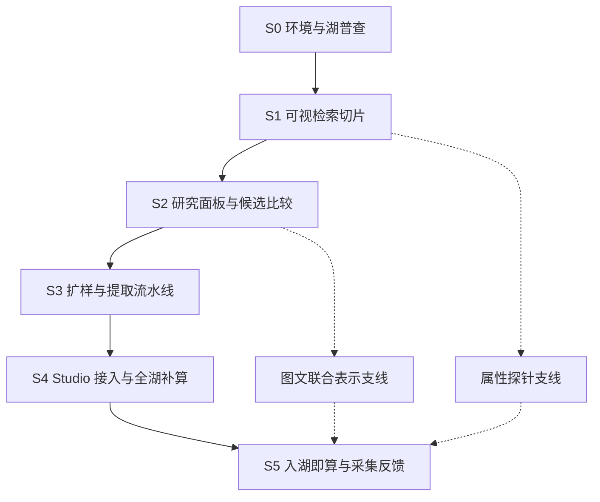

# 实施方向与推进顺序

日期：2026-10-11。状态：工程实施的方向规划，承接[总体规划](README.md)、[模型选型](model-selection.md)与[评估方案](evaluation-plan.md)。本文确定整体方向、各阶段目标和先后顺序，并列出交给后端实施设计的约束；进程协议、数据库模式、文件格式、HTTP/SDK 接口与模块划分由后续实施设计和架构决策确定，本文不冻结。

## 总体方向

### 一条提取核心，两种宿主

研究期和产品期共用同一套特征提取核心：有序读取 → 解码 → 输入配方 → 模型 → 分片写入。研究脚本（邻居浏览、对照评估、聚类试验）只消费提取结果，不各自复制一套读图和预处理逻辑。这样 A0 切片中修正过的预处理、失效记录与配方标识可以原样进入 Studio，避免研究代码和生产代码各写一遍、结果对不上。

核心先以命令行形式在研究目录运行；进入 Studio 接入阶段后，由引擎按现有 lake-worker 的方式托管：源码随引擎分发，解释器单独配置，进程受监督并可恢复。

### 独立视觉运行环境

视觉计算使用独立 Python 环境和独立进程，不并入 lake-worker：

- PyTorch、CUDA 与模型依赖体积大、更新节奏快，不应影响采集服务的依赖锁定与升级。
- GPU 显存不足、驱动异常或模型加载失败只影响视觉任务，不连带采集与归档。
- 资源模型不同：采集受网络与磁盘约束，视觉计算受解码与 GPU 约束，分开准入更容易说明。

Rust 原生推理（ONNX Runtime、candle 等）暂缓。当前候选模型多、预处理仍在变，NaFlex 与 Gemma 4 视觉路径依赖较新的 Transformers 实现；在吞吐瓶颈实测位于 Python 推理之前，不为此付出转换和对齐成本。生产模型确定后可按实测重新评价。

当前机器为 RTX 5090 D（Blackwell），需使用支持该架构的 CUDA 与 PyTorch 构建；环境安装脚本固定版本，并在握手阶段报告驱动、CUDA、设备与显存。

### 读一次，多路计算

图片与原始元数据归档位于机械盘上的物理包，全湖处理的主导成本是读盘和解码，而不是某一个模型的推理。全湖处理因此按物理包与偏移顺序读取，每张图解码一次，同时送入本轮声明的多个计算头：SHA 核对、感知哈希、SSCD、内容特征、画风特征等。候选模型规模都不大，可在 32 GiB 显存中同时驻留。

研究期的 2 万～10 万张分层样本跨越大量物理包，不适合反复随机读取机械盘。样本冻结后，原始字节一次性复制到 SSD 上的样本缓存，后续配方迭代只读缓存。缓存只是研究材料，记录来源引用和字节哈希，不是新的数据湖或来源身份。

### 以内容哈希和配方标识组织特征

特征按“已校验内容 SHA-256 + 计算配方标识”保存，跨湖、跨项目复用，不改变 `source_id + asset_id` 来源身份。配方标识沿用 lake-worker 图片配方（`storage_profile`）的思路：对规范化的配方内容求摘要，至少涵盖权重修订与文件哈希、预处理与输入预算、区域设置、前向精度、输出头和实现版本。任一项变化即为新配方，旧结果保留可读。

特征材料按追加分片写入，配套覆盖与状态目录记录成功、未计算、失败、缺失和不支持。检索索引、邻居图、复制组和聚类都是可重建的派生物，标注其消费的特征配方与覆盖版本。

### 以邻居图作为共同中间层

对每个特征空间，先计算固定版本的 k 近邻图（候选 k=50 左右，由实验确定），再从同一张图派生多种结果：

| 派生结果          | 使用的特征             | 说明                                       |
| ----------------- | ---------------------- | ------------------------------------------ |
| 近重复候选        | 感知哈希、SSCD         | 图片对与距离证据，供校准与人工复核         |
| 高置信度复制组    | 校准后的复制关系       | 用于聚类前去重或降权                       |
| 相似检索          | 内容、画风空间         | 直接读取邻居或在线查询                     |
| 多粒度聚类        | 内容、画风空间         | 聚类实现可替换，邻居图用于审阅与稳定性检查 |
| 离群与稀缺度      | 到第 k 个邻居的距离等  | 标记待分析成员，不自动视为噪声或高价值     |
| 采集候选的新颖度  | 候选与本地库的最近距离 | 服务 Pinterest、Pixiv 的优先级建议         |

研究规模使用精确检索（GPU 暴力检索即可），避免近似索引的漏召回混入模型比较。全湖规模才引入近似索引，并在有界子集上与精确结果对照召回。

### 人工标注是长期资产

模型和配方会更换，人工判断的图片对、困难样本和属性确认会一直有用。从 A0 起，人工判断就写入持久的研究标注库，记录判断者、时间、结论（相近、不同、不能确定）、依据与当时看到的配方；不保存在浏览页的本地存储中。复制关系、画风对照、探针验证和 AI 生成识别共用这套标注机制，按任务分开记录。

## 阶段目标与顺序

S1～S3 对应[评估方案](evaluation-plan.md)的 A0、A/B、C 阶段，S4、S5 对应 D、E 阶段。各阶段的“完成标志”是进入下一阶段的依据，不是工期承诺。

### S0：环境与湖普查

目标是让后续每一步都有可复现的运行条件和真实的分布数据。

- 视觉运行环境：安装脚本、依赖锁定、设备握手、模型权重登记（修订、文件哈希、许可条件）与离线加载。DINOv3 等需许可的权重由用户在模型页确认后获取。
- 湖普查：优先使用已有目录与元数据，不读取图片包，统计各湖的图片数量、格式、保存配方（原图、`webp-2048-q95` 或自定义）、尺寸、长宽比、透明与动画比例，以及跨湖 SHA 重叠。
- 样本缓存工具：按冻结的分层样本清单，把原始字节有序复制到 SSD 缓存并核对哈希。

普查直接服务待定问题：长宽比分布决定 NaFlex 与 EmbeddingGemma 2 的输入预算是否够用；分辨率与保存配方分布决定画风多尺度区域是否可行。以 `webp-2048-q95` 保存的图片最长边已限制在 2048，且带有损编码痕迹，近原生分辨率区域与 SSCD 校准都需按保存配方分层。跨湖 SHA 重叠给出近重复规模的下界。

完成标志：环境在本机可复现，权重登记完整，普查报告与样本清单形成，样本缓存可用。

### S1：可视检索切片

目标是尽早用眼睛发现失效方式，而不是得出选型结论。

- 约 2 万张分层样本；计算头为感知哈希、NaFlex（784 patch）、Kaloscope 3.0（发布配方）与原版 DINOv3。
- 每个特征空间建立精确 k 近邻；浏览页并排展示同一查询在不同空间中的邻居，并标出同 SHA、高相似哈希和同画师等已知关系。
- 浏览页可直接录入人工判断，写入研究标注库。
- 同时记录读取、解码、预处理、推理各段耗时，初步检验“瓶颈在读盘与解码”的假设。

完成标志：失效方式清单（水印、签名、边框、留白、内容压过画风、副本挤占邻居等）形成，并转化为困难图片对与预处理修订；首批人工判断入库。

### S2：研究面板与候选比较

目标是对内容、画风、近重复分别给出有人工依据的主候选。

- 固定研究面板与困难图片对，按作品家族划分以防泄漏。
- 近重复：标注图片对，校准感知哈希与 SSCD，确定高置信度复制组的规则与聚类前去重/降权方式。
- 内容：NaFlex 与 EmbeddingGemma 2 纯图像对比，记录实际输入与有效 patch／token 数。
- 画风：Kaloscope 3.0、原版 DINOv3、Kaloscope 2.0 在发布配方、整图保比例和多尺度局部组合上对照；CSD 视权重状况补充。
- 聚类试验：复制组去重/降权与不处理的对照拟合，多种粒度与随机种子的稳定性。

完成标志：每个任务确定主候选与配方，或明确记录仍需解决的关键缺陷；形成第一份需要固化的特征、配方与标注结构清单，交给实施设计。

### S3：扩样与提取流水线

目标是把提取核心做成可长期运行的流水线，并用 5～10 万张样本证明其可恢复、可增量、资源有界。

- 按物理包顺序读取，单次解码多路计算；读取、解码、GPU 与写入之间有界队列与背压。
- 分片提交、取消、恢复与增量补算；覆盖统计不静默丢失失败项。
- 分段吞吐报告：冷/热缓存、各计算头的边际成本、峰值显存与内存、材料体积。
- 由实施设计形成架构决策：视觉进程的托管与协议、特征材料与覆盖目录的格式、标注库归属、派生物的版本与生命周期。

完成标志：中断后可从检查点继续且无重复或遗漏；吞吐数据足以估算全湖补算时长；相关架构决策成文。

### S4：Studio 接入与全湖补算

目标是让分析结果在项目内可浏览、可用来派生工作集，同时保留身份、版本和来源依据。

- 共享特征材料与覆盖状态接入引擎，项目以引用方式消费固定版本。
- 首期界面：以图搜图（内容/画风两个空间分开）、近重复与复制组浏览、多粒度簇浏览（代表图、边界与离群成员）、人工判断录入、从簇或检索结果派生工作集。
- 全湖补算按“读一次，多路计算”执行，只运行 S2 确定的主候选计算头；按湖和优先级分批，可随时暂停。
- 前端只拿分页结果与范围引用，不搬运全湖 ID 或向量。

完成标志：用户能在 Studio 内完成“找相似 → 看复制关系 → 按簇筛选 → 保存工作集”的完整流程；全湖覆盖进度与失败原因可见。

### S5：入湖即算与采集反馈

目标是让新数据不再回读机械盘，并让分析结果真正影响 Pinterest、Pixiv 的采集投入。

- 入湖即算：新下载的原件在 SSD 暂存、尚未归档到机械盘时计算特征。交接点基于 lake-worker 已有的发布批次（Pinterest 已有不可变结果 outbox），具体机制由实施设计确定；视觉进程作为下游消费者，视觉侧故障不阻塞采集与归档，未计算项由补算兜底。
- 新颖度收益：对每个采集入口（Pin、图版、搜索、推荐、作者）统计新增图片中“非近重复、属于目标内容”的比例，即该入口的有效新增率。lake-worker 已记录发现上下文与入口统计，可在此基础上关联。
- 优先级建议：以有效新增率、稀缺内容覆盖与取得成本为依据，输出可解释的入口排序建议，保留探索预算；先人工采纳，证据充分后再讨论自动调整预算。

完成标志：新入湖图片的特征覆盖不依赖全湖补算；至少一轮 Pinterest 或 Pixiv 采集在可比预算下展示了建议排序与有效新增率的对照记录。

### 支线

- **属性探针**：S1 产生内容特征后即可开始，成本很低。先做漫画、线稿、截图、照片等来源标签较可靠的属性；AI 生成识别单独验收。S5 之前需完成 Pinterest 人工样本上的迁移评估，才能进入采集建议。
- **图文联合表示**：S2 纯图像比较之后开始。EmbeddingGemma 2 结合标题、说明、标签与图版名称，以及多图集合表示；服务 Pinterest 图版评价和 Pixiv 作品系列，结果在 S5 进入优先级建议。

## 交给实施设计的约束

以下是需求侧约束，具体实现由后端实施设计决定：

| 方面       | 约束                                                                                   |
| ---------- | -------------------------------------------------------------------------------------- |
| 身份       | 特征以内容哈希复用，不合并来源身份；派生关系不触发原湖删除或来源记录合并               |
| 配方       | 配方标识覆盖权重、预处理、预算、区域、精度与实现版本；旧配方结果可读                   |
| 读取       | 全湖处理按物理包顺序；避免机械盘随机读；研究样本走 SSD 缓存                            |
| 资源       | 读取、解码、GPU、写入分段有界；不与采集服务争抢未声明的资源；资源等待不记为图片失败    |
| 恢复       | 分片提交、取消、恢复、增量补算；失败与重试保留关联                                     |
| 隔离       | 视觉进程独立于 lake-worker；视觉故障不阻塞采集、归档与项目浏览                         |
| 派生物     | 邻居图、复制组、聚类、索引均可重建，记录所消费的特征版本与参数                         |
| 标注       | 人工判断持久保存，与来源标签、模型预测分开；记录判断时的配方                           |
| 界面       | 有界分页与范围引用；不在前端传输全湖 ID 或向量                                         |
| 本地材料   | 权重、特征、索引、样本缓存、标注库与逐项日志在受管本地目录，不提交 Git                 |

## 暂不纳入的事项

- 自动删除原湖文件或自动合并来源记录。
- 下载前远端缩略图预筛；入湖即算稳定后再按[总体规划](README.md)的边界单独评价。
- 领域微调与自训练画风模型；在主候选的具体缺陷明确之前不启动。
- 采集预算的全自动调整；S5 只产出建议与对照记录。
- 向量截断、降维与量化。
